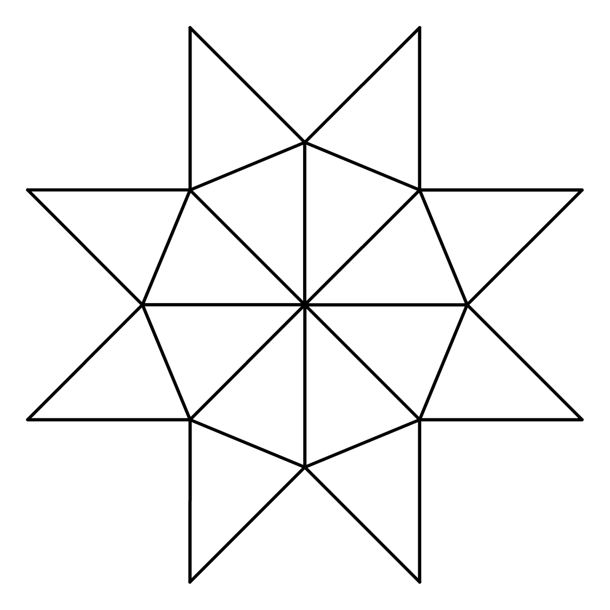

# 太阳花

用正多边形生成放射状太阳花图案，白底黑线，输出 SVG 和 PNG。



## 安装

Python 3.10+；只有生成 PNG 需要 Pillow。

```powershell
python -m pip install -r requirements.txt
```

## 用法

```powershell
python sun.py -n 8
python sun.py -n 12 -a 30 -o output/twelve
python sun.py -n 8 -f svg
python sun.py -n 8 --scale 3 -o output/large
```

默认输出 `output/sun_flower.svg` 和 `output/sun_flower.png`。

## 参数

| 参数 | 说明 | 默认 |
|---|---|---|
| `-n, --sides` | 正多边形边数，3–360，必填 | — |
| `-a, --tip-angle` | 花瓣尖角（度），(0, 180) | `360 / 边数` |
| `-w, --line-width` | 线宽 | `3` |
| `--radius` | 顶点到中心的距离（外接圆半径） | `150` |
| `--margin` | 图像边距 | `24` |
| `--scale` | PNG 缩放比例 | `2` |
| `-f, --format` | `svg`、`png` 或 `both` | `both` |
| `-o, --output` | 输出基础路径，不能是已存在的目录 | `output/sun_flower` |

## 几何

在圆周上取正 n 边形顶点，在每条边的角平分线上找尖点，与边的两个端点组成等腰三角形。尖角默认取外角 `360/n`，此时尖点落在 `2R·cos(π/n)` 处。

## 开发

```powershell
python -m unittest discover -s tests -q
```
